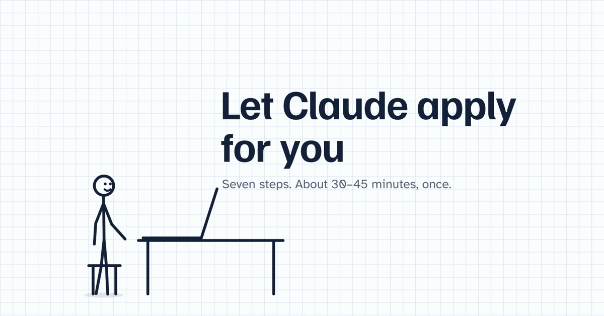
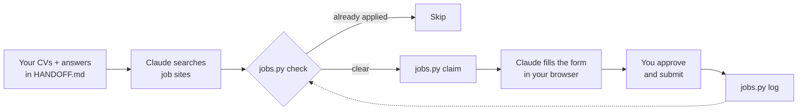

<p align="center">
  <a href="https://twentifo2404-lang.github.io/jobsearch-kit/"></a>
</p>

<h1 align="center">Job Search Kit</h1>

<p align="center">
  Let Claude apply for jobs for you, in your own browser, without ever applying to the same job twice.
</p>

<p align="center">
  <a href="https://twentifo2404-lang.github.io/jobsearch-kit/"><b>Step-by-step guide</b></a> ·
  <a href="#setup-about-15-minutes">Setup</a> ·
  <a href="#applying">Applying</a> ·
  <a href="#how-it-works">How it works</a>
</p>

<p align="center">
  
  
  
  
</p>

> **New to Claude or GitHub? Start with the [step-by-step guide](https://twentifo2404-lang.github.io/jobsearch-kit/).** It covers subscribing, installing everything and your first batch of applications. No coding needed.

- **You stay in control.** Claude fills forms using only answers you've confirmed. You type every password, tick every consent box and approve every message to a recruiter.
- **One log.** Every application, skip and failure goes into `application_log.csv` through `jobs.py`, so nothing gets applied to twice, even with two agents working at once.
- **Everything stays on your computer.** Your CVs, answers and log are git-ignored and never leave your machine.

## What you need
- A Claude Pro or Max plan, with the **Claude desktop app** (Code tab) or **Claude Code** in a terminal
- The **Claude in Chrome** extension, signed in to your job sites (LinkedIn, JobStreet, Indeed…)
- Python 3.8+ (macOS, Windows or Linux)
- Optional: Codex, if you want a second agent applying in parallel

## Setup (about 15 minutes)
1. Click **Use this template** on GitHub (or clone it) to make your own **private** copy, then download it to your computer.
2. Put your CV PDFs in `cv/`.
3. Open the folder in Claude Code / the desktop app's Code tab and say:
   > set me up
   
   Claude runs the `jobsearch-setup` skill: it reads your CVs, asks about the roles you want, your deal-breakers and the usual screening answers, and writes `HANDOFF.md`.
4. Check `HANDOFF.md` yourself. Everything Claude puts on a form comes from there.

## Applying
Say something like:
> apply for jobs: 10 from LinkedIn and JobStreet, posted in the last 3 days

Claude runs the `apply-jobs` skill: it searches, checks each job against your skip rules and the log, shows you a shortlist, applies one by one, and logs every result. When a form asks something new, it asks you and saves the answer to `HANDOFF.md` for next time.

Useful commands:
```bash
python3 jobs.py recent 20     # latest applications
python3 jobs.py claims        # what an agent is applying to right now
```

## How it works

Every job goes through `check` → `claim` → `log`. The claim stops two agents (say Claude and Codex) grabbing the same job at once, and the log stops anyone applying twice.

## Two people on one computer
Say "set up a second person called sam". Their files go in `candidates/sam/`, and Claude adds `--candidate sam` to every command for them, so the two logs never mix.

## What's in here
| File | Purpose |
|---|---|
| `docs/` | The beginner guide website (https://twentifo2404-lang.github.io/jobsearch-kit/) |
| `AGENTS.md` | Rules every agent follows (shared by Claude and Codex) |
| `CLAUDE.md` | Points Claude to AGENTS.md and the skills |
| `HANDOFF.template.md` | Blank profile; setup turns it into your `HANDOFF.md` |
| `jobs.py` | The log and duplicate checker (check → claim → log) |
| `.claude/skills/` | `jobsearch-setup` and `apply-jobs` |
| `cv/` | Your CVs (git-ignored) |

## Good to know
- **Job site rules:** LinkedIn and some boards don't allow automated tools and can restrict accounts that apply too fast. Keep batches modest and spread them out.
- **Review the work.** Spot-check submitted applications, especially early on.
- **Keep your copy private** and don't commit your personal files. `.gitignore` already blocks CVs, logs, `HANDOFF.md` and `candidates/`.

## Video credits
The walkthrough video in `docs/media/` is narrated by an AI voice made with [OmniVoice](https://huggingface.co/k2-fsa/OmniVoice) (Han Zhu and coauthors), whose model licence is CC BY-NC. The video is therefore for non-commercial use only, and the MIT licence covers the code, not the video. Sound effects are from Pixabay.
